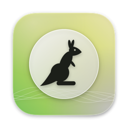
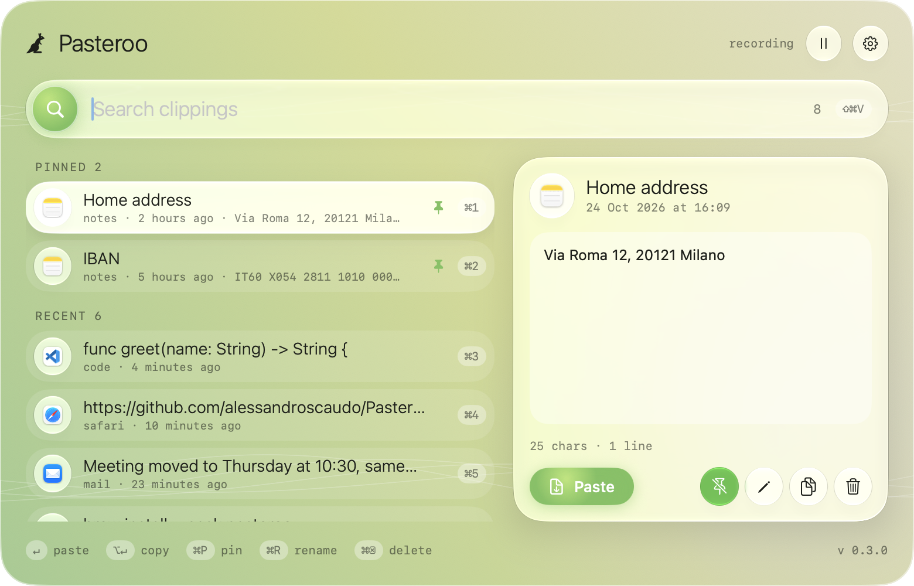
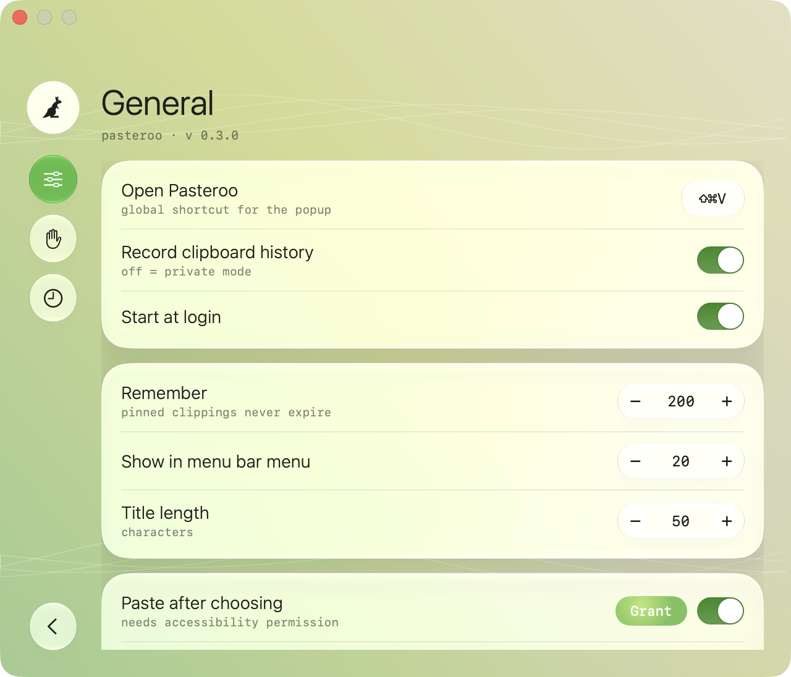

<div align="center">

**English** · [Italiano](docs/readme/README_it.md)



# Pasteroo

### The clipboard manager that lives in your Mac's menu bar.

**Everything you copy, one shortcut away.**

[](https://github.com/alessandroscaudo/Pasteroo/releases/latest)
[](https://github.com/alessandroscaudo/Pasteroo/releases)
[](#quick-start)
[](#quick-start)

[Quick start](#quick-start) · [Features](#features) · [Keyboard shortcuts](#keyboard-shortcuts) · [Privacy](#privacy) · [FAQ](#faq)

**[⬇ Download the latest version](https://github.com/alessandroscaudo/Pasteroo/releases/latest)**

</div>

> [!IMPORTANT]
> Download Pasteroo only from the [Releases page](https://github.com/alessandroscaudo/Pasteroo/releases) of
> this repository. Updates arrive inside the app and are checked against a signature, so you never need to
> download it again from anywhere else.

<div align="center">

<br />



<br /><br />

</div>

---

Copied something ten minutes ago and copied over it since? Press **⇧⌘V**, type a few letters and press
**Return**: Pasteroo pastes it straight into the app you are typing in.

Pasteroo remembers the text you copy, without duplicates, and keeps the things you reuse every day pinned
at the top. It runs in the menu bar with no Dock icon, and your history never leaves your Mac.

The app is in **English** and **Italian** and follows your macOS language.

## Quick start

1. Download `Pasteroo-<version>.zip` from the [latest release](https://github.com/alessandroscaudo/Pasteroo/releases/latest).
2. Open the zip and drag **Pasteroo** into **Applications**.
3. Open Pasteroo. The first time, macOS blocks it because it is not signed by a developer registered with
   Apple. Close the warning, go to **System Settings › Privacy & Security**, scroll down and click
   **Open Anyway** next to Pasteroo. Or, from Terminal:

   ```sh
   xattr -dr com.apple.quarantine /Applications/Pasteroo.app
   ```

4. The kangaroo appears in the menu bar. Press **⇧⌘V** to open the panel.

Two macOS permissions make it work without interruptions. macOS asks for them when they are first needed,
and **Settings…** in the Pasteroo menu has a shortcut to each:

| Permission | Where | Why |
| --- | --- | --- |
| **Paste from Other Apps** | System Settings › Privacy & Security › Paste from Other Apps → **Allow**, then restart Pasteroo | Without it, macOS asks for permission on every copy |
| **Accessibility** | System Settings › Privacy & Security › Accessibility | Lets Pasteroo paste for you. Without it, the chosen clipping is only copied and you paste with ⌘V |

To start Pasteroo when you log in, turn on **Start at login** in its settings.

## Features

<table>
<tr>
<td width="50%" valign="top">

**🔎 Instant search**<br />
Open the panel from anywhere, type to filter, arrows to move, Return to paste.

**📌 Pinned and named clippings**<br />
Keep addresses, IBANs and snippets at the top. Give them a name so you find them by meaning.

**⚡ Paste where you are**<br />
The clipping goes straight into the app you were typing in. ⌥Return only copies it.

</td>
<td width="50%" valign="top">

**📋 Menu bar menu**<br />
Your latest clippings one click away; keys 1–0 pick them directly.

**🙈 Private by default**<br />
Passwords from password managers are never recorded. Exclude any app, or pause recording with one click.

**🔄 Automatic updates**<br />
Pasteroo checks for new versions and installs them when you agree.

</td>
</tr>
</table>

<div align="center">

</div>

## Keyboard shortcuts

In the panel:

| Keys | Action |
| --- | --- |
| **⇧⌘V** | Open or close the panel (change it in Settings) |
| **↑ ↓** | Move through the clippings |
| **Return** | Paste the selected clipping |
| **⌥ Return** | Copy it without pasting |
| **⌘1 … ⌘9** | Paste the clipping with that number |
| **⌘P** | Pin or unpin |
| **⌘R** | Rename |
| **⌘⌫** | Delete |
| **⌘,** | Settings |
| **esc** | Close |

## Privacy

- Your history is stored only on your Mac, in `~/Library/Application Support/Pasteroo/history.json`.
- Pasteroo's only network connection is the check for updates.
- Content that apps mark as concealed or transient, like passwords from 1Password and other password
  managers, is never recorded.
- Under **Ignored apps** you can add any app: nothing copied while it is in front is recorded.
- Turn off **Record clipboard history** for a private mode.

## FAQ

<details>
<summary><strong>macOS says Pasteroo "can't be opened" or is from an unidentified developer</strong></summary>

Pasteroo is signed with its own certificate, not with a paid Apple Developer ID, so Gatekeeper asks you to
confirm once. Use **Open Anyway** in System Settings › Privacy & Security, or the `xattr` command in
[Quick start](#quick-start). Updates do not need this again.
</details>

<details>
<summary><strong>macOS asks to allow clipboard access on every copy</strong></summary>

Since macOS 15.4, apps that read the clipboard need permission. Set Pasteroo to **Allow** in System
Settings › Privacy & Security › **Paste from Other Apps**, then restart Pasteroo: the change applies only
after a restart. Pasteroo's settings show **Open settings** and **Restart** buttons while this is missing.
</details>

<details>
<summary><strong>Pasteroo copies the clipping but does not paste it</strong></summary>

Pasteroo needs the **Accessibility** permission to paste for you. If Pasteroo is already switched on in
that list but still asks, select it, remove it with **−**, then restart Pasteroo and allow it again.
</details>

<details>
<summary><strong>How do I update?</strong></summary>

Pasteroo checks for updates by itself and asks before installing. To check now: menu › **Check for Updates…**.
</details>

<details>
<summary><strong>How do I uninstall it?</strong></summary>

Quit Pasteroo (menu › **Quit Pasteroo**) and move it to the Trash. To delete your history too, remove the
folder `~/Library/Application Support/Pasteroo`.
</details>

---

<div align="center">
<sub><a href="https://github.com/alessandroscaudo">Alessandro Scaudo</a><br/> · requires macOS 14 Sonoma or later</sub>
</div>
