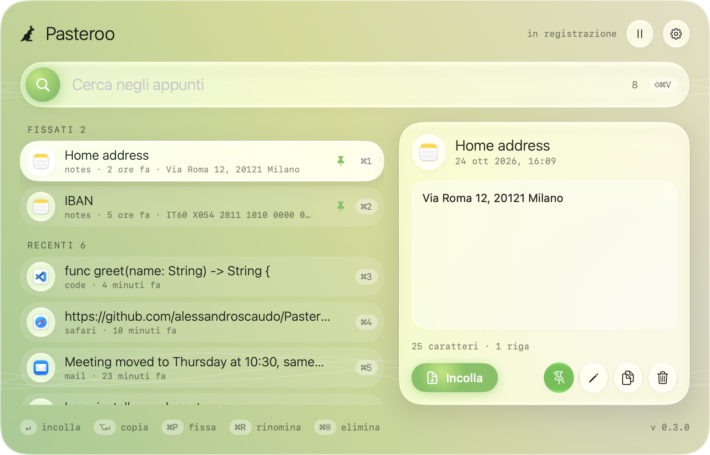

<div align="center">

[English](../../README.md) · **Italiano**


# Pasteroo

### Il clipboard manager che vive nella barra dei menu del tuo Mac.

**Tutto quello che copi, a una scorciatoia di distanza.**

[](https://github.com/alessandroscaudo/Pasteroo/releases/latest)
[](https://github.com/alessandroscaudo/Pasteroo/releases)
[](#per-iniziare)
[](#per-iniziare)

[Per iniziare](#per-iniziare) · [Funzioni](#funzioni) · [Scorciatoie](#scorciatoie-da-tastiera) · [Privacy](#privacy) · [Domande frequenti](#domande-frequenti)

**[⬇ Scarica l'ultima versione](https://github.com/alessandroscaudo/Pasteroo/releases/latest)**

</div>

> [!IMPORTANT]
> Scarica Pasteroo solo dalla [pagina Releases](https://github.com/alessandroscaudo/Pasteroo/releases) di
> questa repository. Gli aggiornamenti arrivano dentro l'app e ne viene verificata la firma: non serve
> riscaricarla da nessun'altra parte.

<div align="center">

<br />



<br /><br />

</div>

---

Hai copiato qualcosa dieci minuti fa e poi ci hai copiato sopra? Premi **⇧⌘V**, scrivi qualche lettera e
premi **Invio**: Pasteroo lo incolla direttamente nell'app in cui stai scrivendo.

Pasteroo ricorda i testi che copi, senza duplicati, e tiene in alto quelli che riusi ogni giorno. Sta nella
barra dei menu, senza icona nel Dock, e la cronologia non lascia mai il tuo Mac.

L'app è in **italiano** e **inglese** e segue la lingua di macOS.

## Per iniziare

1. Scarica `Pasteroo-<versione>.zip` dall'[ultima release](https://github.com/alessandroscaudo/Pasteroo/releases/latest).
2. Apri lo zip e trascina **Pasteroo** nella cartella **Applicazioni**.
3. Apri Pasteroo. La prima volta macOS lo blocca, perché l'app non è firmata da uno sviluppatore registrato
   presso Apple. Chiudi l'avviso, vai in **Impostazioni di Sistema › Privacy e sicurezza**, scorri in fondo
   e clicca **Apri comunque** accanto a Pasteroo. Oppure, da Terminale:

   ```sh
   xattr -dr com.apple.quarantine /Applications/Pasteroo.app
   ```

4. Il canguro compare nella barra dei menu. Premi **⇧⌘V** per aprire il pannello.

Due permessi di macOS lo fanno funzionare senza interruzioni. macOS li chiede la prima volta che servono, e
**Impostazioni…** nel menu di Pasteroo ha una scorciatoia per ognuno:

| Permesso | Dove | Perché |
| --- | --- | --- |
| **Incolla da altre app** | Impostazioni di Sistema › Privacy e sicurezza › Incolla da altre app → **Consenti**, poi riavvia Pasteroo | Senza, macOS chiede il permesso a ogni copia |
| **Accessibilità** | Impostazioni di Sistema › Privacy e sicurezza › Accessibilità | Permette a Pasteroo di incollare al posto tuo. Senza, l'elemento scelto viene solo copiato e incolli tu con ⌘V |

Per avviare Pasteroo all'accensione del Mac, attiva **Avvia al login** nelle sue impostazioni.

## Funzioni

<table>
<tr>
<td width="50%" valign="top">

**🔎 Ricerca istantanea**<br />
Apri il pannello da qualsiasi app, scrivi per filtrare, frecce per muoverti, Invio per incollare.

**📌 Elementi fissati e rinominati**<br />
Tieni in alto indirizzi, IBAN e frammenti di testo. Dai loro un nome per ritrovarli subito.

**⚡ Incolla dove sei**<br />
L'elemento finisce direttamente nell'app in cui stavi scrivendo. ⌥Invio lo copia soltanto.

</td>
<td width="50%" valign="top">

**📋 Menu nella barra**<br />
Gli ultimi elementi a un clic; i tasti 1–0 li scelgono direttamente.

**🙈 Riservato di serie**<br />
Le password dei password manager non vengono mai registrate. Escludi qualsiasi app o metti in pausa con un clic.

**🔄 Aggiornamenti automatici**<br />
Pasteroo controlla da solo le nuove versioni e le installa quando sei d'accordo.

</td>
</tr>
</table>

<div align="center">

</div>

## Scorciatoie da tastiera

Nel pannello:

| Tasti | Azione |
| --- | --- |
| **⇧⌘V** | Apre o chiude il pannello (si cambia nelle impostazioni) |
| **↑ ↓** | Scorre gli elementi |
| **Invio** | Incolla l'elemento selezionato |
| **⌥ Invio** | Lo copia senza incollarlo |
| **⌘1 … ⌘9** | Incolla l'elemento con quel numero |
| **⌘P** | Fissa o togli dai fissati |
| **⌘R** | Rinomina |
| **⌘⌫** | Elimina |
| **⌘,** | Impostazioni |
| **esc** | Chiude |

## Privacy

- La cronologia resta solo sul tuo Mac, in `~/Library/Application Support/Pasteroo/history.json`.
- L'unica connessione di rete di Pasteroo è il controllo degli aggiornamenti.
- I contenuti che le app segnano come riservati o temporanei, come le password di 1Password e degli altri
  password manager, non vengono mai registrati.
- In **App ignorate** puoi aggiungere qualsiasi app: quello che copi mentre è in primo piano non viene
  registrato.
- Spegni **Registra la cronologia** per una modalità privata.

## Domande frequenti

<details>
<summary><strong>macOS dice che Pasteroo "non può essere aperto" o è di uno sviluppatore non identificato</strong></summary>

Pasteroo è firmato con un certificato proprio, non con un Developer ID a pagamento di Apple, quindi
Gatekeeper chiede di confermare una volta. Usa **Apri comunque** in Impostazioni di Sistema › Privacy e
sicurezza, oppure il comando `xattr` in [Per iniziare](#per-iniziare). Gli aggiornamenti non lo richiedono più.
</details>

<details>
<summary><strong>macOS chiede di consentire l'accesso agli appunti a ogni copia</strong></summary>

Da macOS 15.4 le app che leggono gli appunti hanno bisogno di un permesso. Imposta Pasteroo su **Consenti**
in Impostazioni di Sistema › Privacy e sicurezza › **Incolla da altre app**, poi riavvia Pasteroo: la
modifica vale solo dopo il riavvio. Finché manca, le impostazioni di Pasteroo mostrano i pulsanti
**Apri impostazioni** e **Riavvia**.
</details>

<details>
<summary><strong>Pasteroo copia l'elemento ma non lo incolla</strong></summary>

Per incollare al posto tuo Pasteroo ha bisogno del permesso **Accessibilità**. Se nella lista Pasteroo è
già attivo ma lo chiede ancora, selezionalo, rimuovilo con **−**, riavvia Pasteroo e consentilo di nuovo.
</details>

<details>
<summary><strong>Come lo aggiorno?</strong></summary>

Pasteroo controlla gli aggiornamenti da solo e chiede prima di installarli. Per controllare subito:
menu › **Controlla aggiornamenti…**.
</details>

<details>
<summary><strong>Come lo disinstallo?</strong></summary>

Esci da Pasteroo (menu › **Esci da Pasteroo**) e spostalo nel Cestino. Per cancellare anche la cronologia,
elimina la cartella `~/Library/Application Support/Pasteroo`.
</details>

---

<div align="center">
<sub><a href="https://github.com/alessandroscaudo">Alessandro Scaudo</a><br/> · richiede macOS 14 Sonoma o successivo</sub>
</div>
